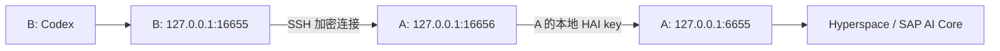

# MVP 架构

2026-11-20 新约束：管理策略明确关闭本机 Remote Login，不修改系统登录或安全策略。当前路径为双方出站 SSH 至 ECS、端到端应用双向 TLS；0.4.0 提供[显式真实 HAI](real-hai.md)，保留隔离的[应用 mock](application-cli.md)。

    B 工具 → B HTTP loopback → 应用 mTLS密文 / B出站SSH → ECS loopback
      → A出站反向SSH → A TLS bridge → A本地HAI → 公司平台

两条SSH均终止于ECS，A不运行SSH服务，也不提供远程命令/文件访问。ECS只转发应用TLS密文，可观察连接元数据并中断流量；不能据此免除公司数据流转许可。A/B固定校验CA、服务名及对端证书指纹，7天身份；B另持独立随机bridge token，HAI/SSO始终只在A。真实与mock服务名/身份隔离，真实认证逐请求从A明确文件读取，不接受环境覆盖；仅开放OpenAI模型API白名单。

Windows mock CLI完整用户报告21/21通过；Mac本机真实mTLS→HAI一次流式调用成功，随后Windows真实B→ECS→A→HAI完整用户报告5/5通过。WSL、实际工具会话与长期恢复仍未验证，见[验证记录](validation.md)。

## 历史系统 SSH 架构（不继续部署）

下述依赖Mac SSH服务的架构和配置行为仅保留作历史参考，不应重新开启被关闭的功能。

## 凭证与请求

初始化时生成随机桥接 token。B 使用该 token，桥接校验通过后替换请求中的 `Authorization`，使用 A 的 HAI key 访问固定的本机上游。公司登录及 OAuth 刷新由 HAI 负责。桥接只读取 Codex auth 文件中的 `OPENAI_API_KEY`。

token 文件和 HAI key 在每次请求时读取，以支持已有文件的凭证轮换。环境变量覆盖值不会热更新，需要重新启动进程。配对文件不包含 HAI key 或 SSO 令牌。

SSH 和桥接 token 提供 MVP 的入口认证。当前 token 代表一个桥接实例，尚无逐用户权限、设备绑定或单独撤销某个 B 的功能。持有该 token 且能通过 SSH 连接的人，可以使用 A 的 HAI 权限。

## HTTP 行为

上游固定为 HTTP loopback origin，监听也限定为 loopback。可选 provider 为 OpenAI、LiteLLM、Anthropic、Gemini，默认只启用 OpenAI。每个 provider 的请求路径和方法均有明确列表，无法将桥接用作任意 URL 代理。

请求和回复以字节流转发，不解析或重写提示词、工具调用、JSON 或 SSE。Node stream 处理背压；请求体大小有上限。连接级 hop-by-hop 头被移除，`User-Agent` 等工具信息保留，`Host` 改为 HAI 上游。上游认证头及 cookie 不返回 B。

HAI 的 HTTP 状态、错误正文、`Retry-After` 与关联 ID 原样传递。桥接本身不跟随重定向，不自动重试模型请求。连接中断后恢复 SSH，并不意味着已经发送的请求会被重放。客户端取消或断开时，桥接关闭对应上游连接。

`GET /healthz` 需要桥接 token，仅表示桥接可用。`doctor` 还读取配置上游的模型列表；模拟上游明确返回 `mock: true`、`hai: not_checked`。真实上游的模型列表成功也不等于实际生成已经通过。

日志只记录方法、允许的路径、状态、耗时和随机请求 ID。查询参数、认证头、提示词和模型回复不写日志。

## 当前证据与未验证项

初始探索已在 Mac 的 `hai 1.4.9` 上完成真实 Responses / SSE 中转。这个结果不等于已经证明后台不存在任何设备或用户策略。源码仓库未获得访问。旧手工 Windows 经 ECS 的内层 SSH 与模拟协议已有成功输出/用户报告；新 CLI、WSL 和真实跨设备 HAI 仍需分别验证。

用户说明已经针对个人设备和特殊场景与 HAI 团队对齐，项目以该具体授权范围进行 MVP 验证，不推断此授权适用于其他设备、用户或用途。

后续可在当前认证入口增加用户身份、设备登记和授权撤销，无需改变 HAI 或模型协议。

ECS 模式将 Mac 的 SSH 22 反向发布到中继 loopback，B 的内层 SSH 通过该入口终止于 Mac，不将明文 HAI HTTP 发布给中继。[中继 CLI](relay-cli.md)只管理前台 SSH 生命周期，不替代服务端权限约束，也不扩大已对齐的真实数据流转授权。
