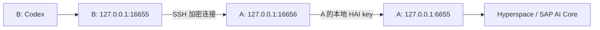

# MVP 架构

## 凭证与请求

初始化时生成随机桥接 token。B 使用该 token，桥接校验通过后替换请求中的 `Authorization`，使用 A 的 HAI key 访问固定的本机上游。公司登录及 OAuth 刷新由 HAI 负责。桥接只读取 Codex auth 文件中的 `OPENAI_API_KEY`。

token 文件和 HAI key 在每次请求时读取，以支持已有文件的凭证轮换。环境变量覆盖值不会热更新，需要重新启动进程。配对文件不包含 HAI key 或 SSO 令牌。

SSH 和桥接 token 提供 MVP 的入口认证。当前 token 代表一个桥接实例，尚无逐用户权限、设备绑定或单独撤销某个 B 的功能。持有该 token 且能通过 SSH 连接的人，可以使用 A 的 HAI 权限。

## HTTP 行为

上游固定为 HTTP loopback origin，监听也限定为 loopback。可选 provider 为 OpenAI、LiteLLM、Anthropic、Gemini，默认只启用 OpenAI。每个 provider 的请求路径和方法均有明确列表，无法将桥接用作任意 URL 代理。

请求和回复以字节流转发，不解析或重写提示词、工具调用、JSON 或 SSE。Node stream 处理背压；请求体大小有上限。连接级 hop-by-hop 头被移除，`User-Agent` 等工具信息保留，`Host` 改为 HAI 上游。上游认证头及 cookie 不返回 B。

HAI 的 HTTP 状态、错误正文、`Retry-After` 与关联 ID 原样传递。桥接本身不跟随重定向，不自动重试模型请求。连接中断后恢复 SSH，并不意味着已经发送的请求会被重放。客户端取消或断开时，桥接关闭对应上游连接。

`GET /healthz` 需要桥接 token，仅表示桥接可用。`doctor` 还读取 HAI 的模型列表，区分桥接连通与 HAI 可用。

日志只记录方法、允许的路径、状态、耗时和随机请求 ID。查询参数、认证头、提示词和模型回复不写日志。

## 当前证据与未验证项

初始探索已在 Mac 的 `hai 1.4.9` 上完成真实 Responses / SSE 中转。这个结果不等于已经证明后台不存在任何设备或用户策略。源码仓库未获得访问，Windows、WSL 和异地 SSH 仍需在实际 B 上验证。

用户说明已经针对个人设备和特殊场景与 HAI 团队对齐，项目以该具体授权范围进行 MVP 验证，不推断此授权适用于其他设备、用户或用途。

后续可在当前认证入口增加用户身份、设备登记和授权撤销，无需改变 HAI 或模型协议。
